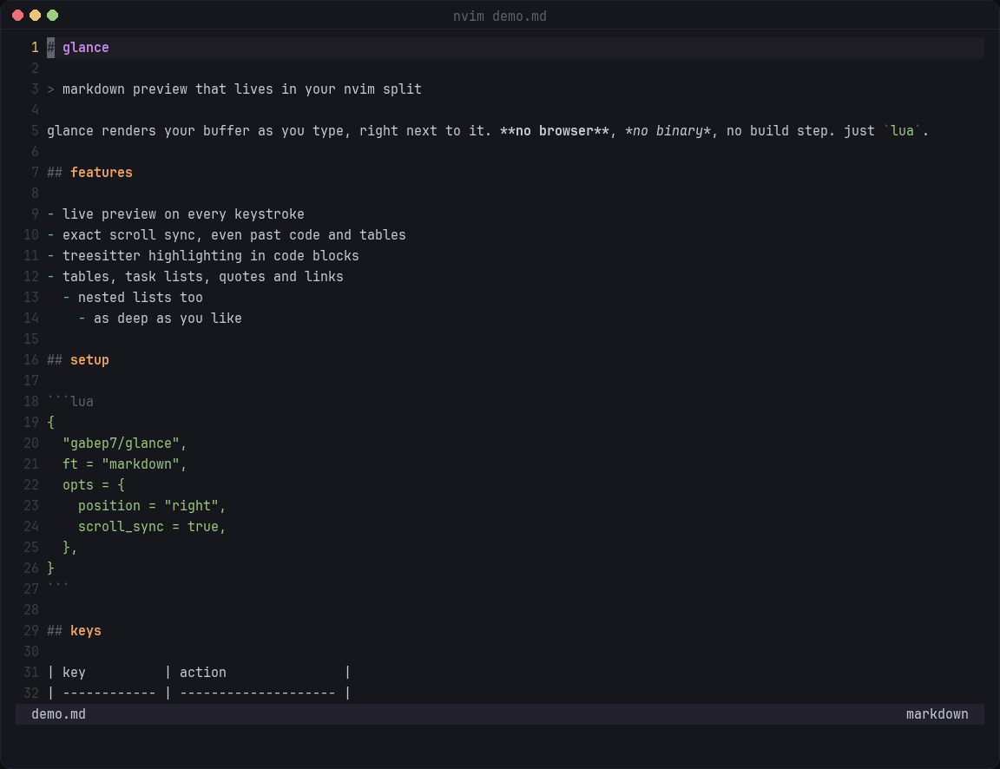

# glance

markdown preview that lives in your nvim split. pure lua, no binary, no browser.



## install

requires neovim 0.9+.

lazy.nvim:

```lua
{
  "gabep7/glance",
  ft = "markdown",
  opts = {},
}
```

add `version = "*"` to stay on tagged releases instead of `main`.

## keymaps

set on markdown buffers:

| key | action |
|-----|--------|
| `<leader>gp` | toggle preview |
| `<leader>gf` | jump to preview / back to source |
| `<leader>gs` | toggle scroll sync |
| `:Glance` | open preview |
| `:GlanceToggle` | toggle preview |
| `:GlanceStop` | close preview |

## config

defaults:

```lua
require("glance").setup({
  debounce = 30,        -- ms after the last edit before re-rendering
  position = "right",   -- "right" or "left"
  width = nil,          -- columns; nil splits evenly
  scroll_sync = true,
  keymaps = {           -- false to disable, or set any key to false
    toggle = "<leader>gp",
    focus = "<leader>gf",
    sync = "<leader>gs",
  },
})
```

highlight groups are `GlanceH1`..`GlanceH6`, `GlanceCode`, `GlanceCodeBlock`, `GlanceLink`, `GlanceQuote`, `GlanceBullet`, `GlanceTableBorder` and friends (see `lua/glance/init.lua`). all are defined with `default = true`, so your colorscheme or config can override them.

## how it works

the preview is a scratch buffer in a split. on every change the source buffer is re-rendered in lua (debounced) and drawn with extmark highlights. code blocks get treesitter highlighting when a parser for the language is installed. each source line maps to a rendered line, so scroll sync stays exact past tables and code blocks.

## tests

```bash
nvim --headless -u NONE -l tests/run.lua
```

regenerate `demo.gif` with `python3 demo/record.py` (needs `msgpack` and `pillow`).
